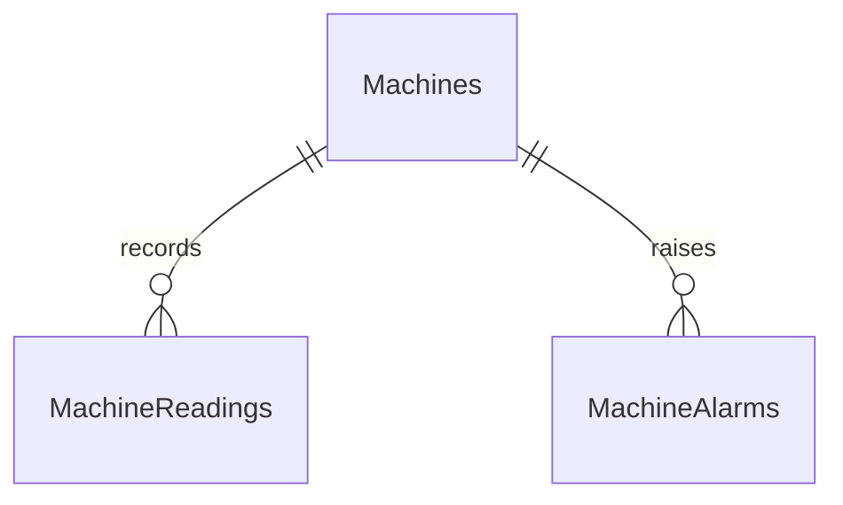

# Database

FactoryPulse AI uses EF Core 10 with SQLite. The domain owns the machine, telemetry and alarm rules. Infrastructure maps those entities, owns the migrations, and executes database queries through the scoped `FactoryPulseDbContext`.

## Entities and relationships

| Table | Contents |
| --- | --- |
| `Machines` | A GUID, canonical uppercase machine code, name, optional description, type, location, status and UTC lifecycle timestamps |
| `MachineReadings` | A generated integer ID, machine ID, UTC timestamp, temperature in °C, vibration in mm/s, rotational speed in rpm, torque in N·m and tool wear as a 0–1 fraction |
| `MachineAlarms` | A generated integer ID, machine ID, alarm code, diagnostic message, severity, UTC creation time and optional UTC acknowledgement and resolution times |



Each reading or alarm belongs to one machine. SQLite restricts deletion of a machine with dependent records. Required fields and SQL checks protect the machine code, text fields, enum values, measurement ranges, and timestamp ordering. Status and severity use stable integer values, and presentation layers can translate labels using those values and the alarm code.

## Indexes and queries

| Table | Index columns | Purpose |
| --- | --- | --- |
| `Machines` | `MachineCode` | Enforce uniqueness and look up a canonical code |
| `MachineReadings` | `MachineId, TimestampUtc` | Scan a machine's readings by time |
| `MachineAlarms` | `MachineId, AcknowledgedAtUtc, CreatedAtUtc` | Support the existing unacknowledged alarm lookup |
| `MachineAlarms` | `MachineId, AlarmCode`, filtered to unresolved rows | Enforce one active occurrence per machine and code |
| `MachineAlarms` | `CreatedAtUtc, Id` and `MachineId, CreatedAtUtc, Id` | Sort global and machine-scoped history |
| `MachineAlarms` | `ResolvedAtUtc, CreatedAtUtc, Id` | Sort active alarms by creation time |

`MachineHistoryQueries.GetPageAsync` returns the machine and independent pages of its readings and active, unacknowledged alarms. Alarm REST queries also expose acknowledged active alarms and resolved history. Pages allow 1–100 rows, use no tracking, and sort newest first with ID as the tiebreaker. Acknowledgement and resolution use separate conditional updates so each preserves the other's timestamp. [Alarm HTTP contract](ALARMS.md)

## Local setup and migrations

`Database:Path` defaults to `data/factorypulse.db` relative to the API content root. In a source checkout that is normally `src/FactoryPulse.Api/data/factorypulse.db`. Set `Database__Path` to an absolute file path in a writable directory to use a different location, such as a mounted volume. The database and SQLite sidecars are ignored by Git.

Run these commands from the repository root to restore the pinned local tool and apply the schema explicitly.

```powershell
dotnet tool restore
$ef = @('--project', 'src/FactoryPulse.Infrastructure', '--startup-project', 'src/FactoryPulse.Api', '--context', 'FactoryPulseDbContext')
dotnet ef database update @ef
```

After changing a mapping, scaffold a migration with a descriptive name, review the migration and model snapshot, and verify the result on a disposable database before updating a durable one.

```powershell
dotnet ef migrations add DescribeChange @ef --output-dir Persistence/Migrations
dotnet ef migrations has-pending-model-changes @ef
dotnet ef database update @ef
```

Apply migrations as part of deployment using configuration for the target environment. The API startup only registers persistence and validates the configured path. The integration suite creates its own in-memory SQLite schema using the same migration.

`20261125225433_AlarmLifecycle` adds `ResolvedAtUtc` and the lifecycle indexes. Before enforcing active uniqueness, it keeps the newest legacy row active for each machine and code, using ID to break timestamp ties. Older duplicates are preserved with a resolution time set to the later of the surviving row's creation time and their own acknowledgement, when present.

`20261126150622_MonitoringIdentity` adds Identity tables and their indexes to the same context. Applying it preserves monitoring data. Rolling it back removes Identity accounts and roles, so back up the database before a rollback. [Account provisioning](AUTHENTICATION.md)

## SQLite and future providers

Timestamps are stored as integer .NET ticks and rehydrated as UTC `DateTime` values. This preserves precision and permits server-side comparison and ordering. SQLite serializes writers and may rebuild tables for some schema changes. EF Core's SQLite provider supports scripts from a known migration version. [SQLite provider limitations](https://learn.microsoft.com/en-us/ef/core/providers/sqlite/limitations).

For SQL Server or PostgreSQL, create a migration set for that provider and review column types, keys, indexes, check expressions and UTC conversion. Move existing records in a separate data migration and verify identifiers, timestamps and constraints against the destination engine.
